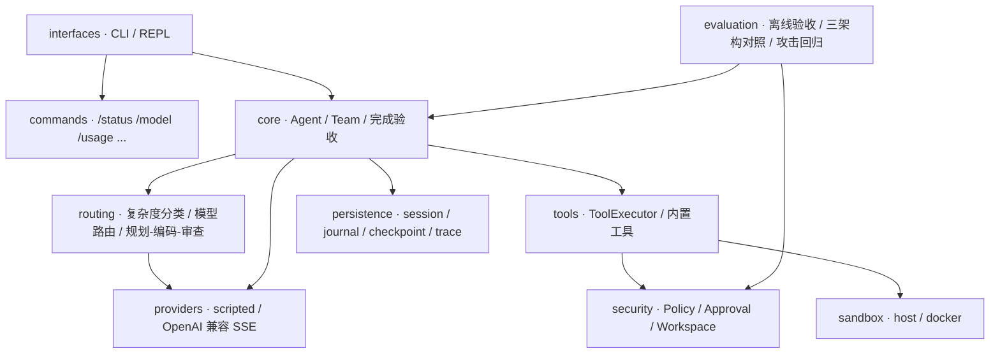

# Pi-Claw

使用 Python 3.12 和 uv 的本地 Coding Agent。提供可恢复会话、流式回复、受控工具执行、
宿主完成验收和离线回归评测。

> **一句话定位**：一个**可审计、可回放、权限受控**的本地 Coding Agent —— 多模型路由、
> 自动规划/编码/审查、Docker 命令隔离，以及**用公开数据集做外生对照的离线回归评测**。

## 快速开始

```bash
uv sync --frozen
uv run --frozen pi-claw demo --yes
uv run --frozen pi-claw chat "检查当前示例工作区" --print
```

默认 scripted 模式完全离线，只验证工具和会话流程。demo 在临时工作区修改示例并运行测试。
实际仓库的写入和命令执行需要审批。

### 干净的默认工作区

从 Pi-Claw 根目录启动时，`chat` / `run` 默认使用 `projects/` 保存生成的代码示例和项目，
首次启动自动创建，不再默认修改 Pi-Claw 自身的 `src/`、`tests/` 或 README。
例如 `projects/hello-world/hello.py`。`projects/` 内的生成内容被 Git 忽略，仅跟踪 `.gitkeep`。
`.env`、模型 TOML 与 `runs/` 仍放在 Pi-Claw 根目录，不搬进生成项目。

显式操作一个已有项目时使用 `--workspace /ABS/PATH/project`；要修改 Pi-Claw 自身则明确用
`--workspace .`。默认路径是**启动目录下的 projects/**，因此推荐先 `cd` 到 Pi-Claw 根目录。
旧会话仍绑定原工作区；恢复以前根目录的会话需显式加 `--workspace .`，不会自动迁移或删除。

## 30 秒离线演示

`demo` 在临时工作区跑一个**确定性、完全离线**的修复流程（读到 bug → 改一处实现 → 跑测试），
不调用任何模型、不联网，退出即清理工作区：

```bash
uv run --frozen pi-claw demo --yes
```

真实输出（节选）：

```json
{
  "status": "completed",
  "steps": 4,
  "verification": {
    "accepted": true,
    "reason": "写入后满足必跑检查：test",
    "changed_files": ["calculator.py"]
  }
}
```

`verification.accepted` 只有在**写后真的跑通测试**时才为 `true`：完成声明不靠模型自述，
而由宿主用已经发生的工具证据验收（见“主要能力 · 完成验收”）。可用
`--trace runs/demo.jsonl` 导出这一步的完整轨迹，再 `pi-claw replay runs/demo.jsonl` 回放。

## 架构概览



一条任务的端到端数据流：

```text
用户任务
  → SessionStore 追加消息，裁剪旧回合的大工具结果 / 必要时压缩活动窗口
  → Provider 流式返回 text_delta / tool_call_delta
  → before_tool Hook → Policy → Approval（需要批准则暂停，不静默放行）
  → ToolExecutor 执行（可选 Docker 断网隔离）→ ToolResult 写回上下文与原始日志
  → 重复调用检测；final 候选经过“完成验收”（写后必须有认可的成功验证证据）
  → RunResult 携带 usage → 幂等写入用量账本 + 可回放 Trace
```

设计要点：

- **依赖方向单向**：`interfaces → core → tools/security/persistence`；Runtime 不导入
  `evaluation`，评测按需加载，评测逻辑不进入产品路径。
- **唯一工具执行入口**：所有模型工具都经过 `ToolExecutor`，统一走 Policy/Approval 与路径边界，
  没有绕过审批的旁路。
- **完成验收不信任模型自述**：`ToolEvidenceCompletionVerifier` 要求“成功写入后出现受认可的成功
  验证命令”；宿主声明的 `VerificationPlan` 还能保护测试文件、拒绝无关测试绿灯。
- **可回放**：一次运行落 `journal` + `checkpoint` + 脱敏 `trace`，可复盘每一步工具调用与结果。
- **三套评测彼此独立**：内部冻结回归、内部分布外 holdout、外部 SWE-bench Verified 互不复用，
  避免“用自己出的题自证”。

## 评测结果摘要

| 评测 | 规模 | 结果 |
|---|---|---|
| 内部冻结回归（阶段 3，同协议） | 10 任务 × 3 架构 × 3 次 = 90 trial | **严格 90/90**（single / workflow / team 各 30/30） |
| 内部分布外 holdout（未见任务） | 3 任务 × 3 架构 × 3 次 = 27 trial | **27/27**（pass@3 = 1.0） |
| 外部 **SWE-bench Verified**（公开集） | 37 个环境健康实例 | 首轮 **54.1%** → 坏例自修复后 **37/37**（Wilson 95% [90.6, 100]） |
| Docker 沙箱攻击回归 | 11 类攻击 × 30 次连续运行 | 全部拦截，Host / Docker 结果一致 |
| 离线单元测试 | 822 项 | `pytest`（另有独立的 `docker_integration` 标记用例） |

产品侧闭环示例：外部评测里首轮坏例以 `loop_detected` 为主（13/17，模型反复发起**参数与结果都
相同**的只读调用、最终空补丁）。把该结论回灌到 `src/core/agent.py`（单 Agent 模式加**软循环恢复**
与**写优先提示**）后复测，循环事件 13 → 0、首轮 20/37 → 29/37，困难实例再由 checkpoint 修复兜底。
详见 [Iteration 040](docs/iterations/ITERATION_040_SWEBENCH_VERIFIED_EXTERNAL_EVAL.md)。

口径说明：外部数字来自本机 aarch64 固定镜像，用**同环境 gold 基线**抵消环境噪声，绝对值不与
官方榜单直接比较；选样限定纯 Python、gold 补丁小、FAIL_TO_PASS ≤ 8，故 100% 不外推到整个
Verified。“首轮 + 自动修复”是评测回路的一部分，已与“首轮”分开报告。

## 连接模型

项目根目录提供 `.env.example`，本机填写 `.env`（Git 已忽略；Finder 中按
`Command + Shift + .` 显示隐藏文件）。从项目目录启动时自动读取 `.env`，终端中已导出的
同名变量优先。可以在 `.env` 中填写当前供应商配套的 API Key、Base URL 和准确模型 ID：

```dotenv
OPENAI_API_KEY=<YOUR_API_KEY>
OPENAI_BASE_URL=<YOUR_CHAT_COMPLETIONS_BASE_URL>
OPENAI_MODEL=<YOUR_MODEL_ID>
```

```bash
uv run --frozen pi-claw chat --provider openai
```

适配 OpenAI-compatible Chat Completions，可配置 Kimi、Qwen、DeepSeek 等服务。
供应商获取入口和配置步骤见 [API Key 指南](docs/API_KEY_GUIDE.md)。
真实服务兼容性和小示例联调记录见 [最新迭代](docs/iterations/ITERATION_011_WORKSPACE_TERMINAL.md)，
离线测试通过不等于所有模型和任务都可用。

chat 默认请求 SSE 流；供应商不支持时使用 `--no-stream`。使用 `--max-attempts 3`
设置请求最多尝试次数。终端 `candidate(stream)>` 表示尚未验收的实时文本。
若正式回复与流式正文完全一致，只打印简短完成状态，不再重复整段 `assistant>`；
工作流只追加新的审查结论。同步回复、修订结果、未完成状态仍会显示，完整消息照常保存。

## 按复杂度选择模型

复制 `pi-claw.example.toml` 为 `pi-claw.toml`。同一服务/网关下的多个模型共用 `.env` 中的
`OPENAI_BASE_URL` 和 `OPENAI_API_KEY`，各 profile 只需填写不同的准确模型 ID，不需要价格：

```toml
[connection]
base_url_env = "OPENAI_BASE_URL"
api_key_env = "OPENAI_API_KEY"

[routing]
intent_strategy = "model"
cheap = "economy"
strong = "primary"

[models.economy]
model = "<YOUR_LOW_COST_TOOL_MODEL_ID>"

[models.primary]
model = "<YOUR_PRIMARY_TOOL_MODEL_ID>"
```

路由时复用 API 地址和 Key，改变请求 JSON 中的 `model`；不会在本机加载模型权重。
路由模式不使用单模型入口的 `OPENAI_MODEL`。若某个 profile 连接另一家服务，须同时显式
配置它的 `base_url`/`base_url_env` 和 `api_key_env`，不能继承半套共享连接。通过显式配置启用路由：

```bash
uv run --frozen pi-claw chat --config pi-claw.toml --route auto
uv run --frozen pi-claw chat --config pi-claw.toml --route primary
uv run --frozen pi-claw eval-routing --output runs/routing-eval.json
```

每回合先让轻量模型只判断 `simple/complex`：简单意图识别、分支选择、短文本提取和单步只读
任务由轻量模型执行；代码修改、调试、架构设计、多步骤任务由主力模型执行。
分类失败或含糊时转主力，明显副作用另有宿主规则兜底；工具失败、轻量执行配额耗尽或越界
工具候选也会升级。模型角色由你指定，不根据未知价格排序。
分类无工具权限、不进入任务历史，但计入总请求和 Token；每回合最多分类一次。
`/model` 查看具体模型或切换，`/status` 查看简明状态，`/status --verbose` 查看分流详情，
`/usage` 查看会话与项目累计 Token。旧配置省略 `intent_strategy` 时仍用本地规则。
请求次数、输出 Token 上限和复现实验见
[配置与模型路由](docs/CONFIGURATION_AND_ROUTING.md)。

## 自动规划、编码与审查

`pi-claw.ustc.example.toml` 中分类、规划、编码和常规审查都使用学校免费的
`deepseek-flash`；只有命中确定性高风险规则时，才通过独立 Moonshot 连接调用用户自费
`kimi-k3` 做第二次只读审查。新克隆可复制为本机 `pi-claw.toml`；已经配置好的文件不要覆盖。
学校连接使用 `.env` 的 `OPENAI_*`，Kimi 使用独立的 `MOONSHOT_*`：

```bash
uv run --frozen pi-claw chat --config pi-claw.toml --route auto --max-steps 24
```

简单问答保留轻量路径，复杂任务进入完整工作流；审查不通过会带问题清单返回编码。
规划和审查被宿主限制为只读，写入与命令仍需审批。审查必须重读改动文件，宿主仍检查写后
验证证据。显式要求、高风险能力、两轮以上常规审查或至少五个改动文件才升级 Kimi；没有成功
改动文件时不调用。Kimi 每个逻辑请求只尝试一次，否决或失败不会伪装成通过。
学校模板最多三轮常规审查、一次高级审查阶段、全回合 36 次逻辑请求，不需要模型价格。
这不是并行子代理，也不自动提交或回滚。准确配置、数据流、预算、恢复边界及待实测项见
[多模型工作流](docs/WORKFLOW_PIPELINE.md)。

## 主要能力

| 能力 | 行为 |
|---|---|
| 工具执行 | 文件读取、搜索、精确修改和白名单 argv 命令，统一经过 Policy/Approval |
| 流式事件 | 文本/工具参数 delta、请求重试、工具结果、上下文变化和运行终态 |
| Token 统计 | 累计服务端 usage；通过 `/usage` 查询当前会话与工作区历史累计，缺口显式提示 |
| 上下文管理 | 确定性压缩、旧回合工具正文裁剪，保留原始日志和调用配对 |
| 请求重试 | 暂时性 HTTP/网络错误有限退避；部分流已输出后不重放 |
| 重复检测 | 近期相同参数与结果重复出现时停止无进展循环 |
| Hooks | 显式注入生命周期回调；前置工具 Hook 可拒绝，不能绕过审批 |
| 会话恢复 | 分段 journal、checkpoint、文件锁和 expected_seq 并发冲突检查 |
| 完成验收 | 修改后缺少认可验证证据时拒绝完成声明，返回 unverified 或继续验证 |
| 离线评测 | 真实工具链、独立工作区并发、机器可读报告和脱敏 Trace |
| 模型路由 | 轻量模型分类、按复杂度分流、失败升级、固定 profile、分模型 Token 与请求上限 |
| 多模型工作流 | DeepSeek 规划/编码/常规审查、按风险升级 Kimi、高级只读隔离和结构化产物持久化 |
| 声明式 Skill | 内置任务执行指导（只读定位、测试修复）；确定性选择、默认关闭、不提权、不执行代码 |
| Docker 命令隔离 | 去敏只读快照、断网非 root 容器、资源硬限制、强制清理和 11 类攻击回归 |

完成验收是最低证据检查，不保证任务业务正确。默认 Host 后端不提供 OS 沙箱；显式 Docker 后端
显著加强命令隔离，但容器仍不是虚拟机。详细边界见 [安全说明](docs/SECURITY.md)。

构建本地固定沙箱镜像并运行确定性安全评测：

```bash
./scripts/build-sandbox-image.sh
uv run --frozen pi-claw chat --config pi-claw.toml --route auto --sandbox docker
uv run --frozen python -m evaluation.sandbox_cases \
  --output runs/stage3-sandbox-eval.json --trials 30
```

评测报告只保存聚合安全/性能指标，不保存 argv、stdout、宿主路径、canary、API Key 或 Base URL。

## 会话与命令

```bash
uv run --frozen pi-claw chat --continue
uv run --frozen pi-claw chat --session <SESSION_ID>
uv run --frozen pi-claw sessions
uv run --frozen pi-claw eval --workers 4
uv run --frozen pi-claw replay <TRACE_PATH>
```

REPL：`/help`、`/status [--verbose]`、`/model [模型ID|auto|别名]`、`/new`、`/sessions`、`/resume <id>`、`/compact`、`/context`、
`/usage`、`/history`、`/title <标题>`、`/exit`。
`/skills` 列出内置 Skill；`/skill auto|<id>|off` 启用自动选择、显式选择或关闭。

在 `pi-claw>` 提示符下输入 `/` 即显示命令菜单，继续输入可筛选；Tab / ↑↓ 选择，回车执行。
`/model ` 补全具体模型 ID 和带模型说明的配置别名，例如 `/model deepseek-flash`；同一 ID
对应多个配置时需用别名。`/exit` 是唯一退出命令，原 `/quit` 别名已移除。
普通终端管道或 `TERM=dumb` 不显示弹出菜单，但 `/` 回车仍可
查看帮助，`/status`、`/exit` 回车仍正常执行。命令补全与帮助不会调用模型，输入历史仅驻留内存。
这些不是 zsh 的系统命令。更新后需退出并重新启动正在运行的 Pi-Claw。

`/status` 默认只显示工作区、会话 ID、具体模型/模式、审批和最近结果。消息数等调试字段移到
`/status --verbose`，其中 `messages` 包含系统和工具消息，不是用户提问次数或 Token。
`/usage` 显示输入、输出、总 Token 及统计缺口；项目按工作区真实路径划分，汇总同一会话存储下
该工作区所有会话，已包含当前会话，不能把两行再次相加。更换 `--workspace` 或 `--data-dir`
会改变统计范围。若要逐个子项目独立计量，启动时指定 `--workspace projects/子项目`。
这些是已持久化的服务端统计，不是账户余额、完整账单或 `/context` 的上下文 Token 估算。
字段解释与验证记录见 [Iteration 012](docs/iterations/ITERATION_012_COMMANDS_AND_PROJECT_USAGE.md)。

会话默认保存在 `~/.pi-claw/sessions/`，可用 `PI_CLAW_HOME` 或 `--data-dir` 调整。
会话后端默认 `files`；设 `PI_CLAW_SESSION_BACKEND=sqlite` 或传 `--session-backend sqlite` 可改用
数据目录下单个 `sessions.sqlite3`（CLI 参数优先于环境变量）。已有会话用 `pi-claw migrate
--workspace <目录> --from files --to sqlite --data-dir <数据目录>` 一次性迁移，源数据保留、
重复运行幂等、冲突在写入前报错；`/context` 会显示当前实际后端。
Trace 和 Eval 报告默认保存在忽略跟踪的 `runs/` 中。

## 目录

```text
pi-claw/                  # Git/uv 项目根目录
├── README.MD             # 项目入口说明
├── .env.example          # 可提交的空密钥模板
├── .env                  # 本机填写，Git 忽略
├── pi-claw.example.toml  # 模型 profile/路由示例
├── pyproject.toml
├── uv.lock
├── src/
│   ├── tools/            # read/write/edit/grep/shell、注册、统一审批执行
│   ├── commands/         # status/model/exit/sessions/help、上下文命令
│   ├── config/           # 配置类型、.env 解析、TOML 加载
│   ├── routing/          # 复杂度分类、模型路由、顺序工作流、用量账本
│   ├── core/             # Agent、消息、上下文、事件、Hooks、完成验收
│   ├── security/         # Policy、Approval、Workspace
│   ├── providers/        # 离线 Provider、HTTP/SSE
│   ├── persistence/      # Session、journal、checkpoint、锁、Trace
│   ├── evaluation/       # 正式 Runtime 离线验收与路由对照
│   └── interfaces/       # CLI、REPL
├── external_eval/        # 独立外部评测（SWE-bench Verified）；不进入主 pytest/CI
├── tests/
├── docs/
├── projects/             # 默认示例/代码项目工作区；生成内容不进入 Pi-Claw Git
├── runs/                 # 本地 Trace 和评测报告，内容不进入 Git
└── scripts/              # 镜像构建、评测进度看板等运维脚本
```

业务模块直接位于 `src/core/`、`src/interfaces/` 等目录，不再嵌套 `pi_claw/`。
Python 导入使用 `from core.agent import Agent`；常用启动命令仍为 `uv run --frozen pi-claw`，
模块启动方式改为 `uv run --frozen python -m interfaces`。

## 开发验证

变更批次的审核、提交、推送和稳定分支集成规则见 [CONTRIBUTING.md](CONTRIBUTING.md)。

```bash
uv run --frozen ruff format --check src tests
uv run --frozen ruff check src tests
uv run --frozen pytest
uv run --frozen pytest -m docker_integration tests/test_docker_sandbox_integration.py
uv run --frozen pi-claw eval --workers 4
uv build --no-config
```

`--frozen` 按现有锁文件运行，避免本机包索引配置导致锁文件地址变化。

## 文档

- [架构与依赖方向](docs/ARCHITECTURE.md)
- [工作流程与数据路径](docs/WORKFLOW_AND_DATA_FLOW.md)
- [运行时能力与 Hooks 接口](docs/RUNTIME.md)
- [配置与模型路由](docs/CONFIGURATION_AND_ROUTING.md)
- [安全与授权边界](docs/SECURITY.md)
- [评测指标](docs/EVALUATION.md)
- [单 Agent、顺序工作流与主从多 Agent 对照](docs/AGENT_MODE_COMPARISON.md)
- [外部评测：SWE-bench Verified 与坏例自修复](docs/iterations/ITERATION_040_SWEBENCH_VERIFIED_EXTERNAL_EVAL.md)
- [声明式 Skill：边界、Manifest 与命令](docs/SKILLS.md)
- [项目范围](docs/PROJECT_SCOPE.md)
- [变更与集成流程](CONTRIBUTING.md)
- [迭代记录](docs/iterations/README.md)

## 许可证

本项目以 [MIT 许可证](LICENSE) 发布。

本轮目录和运行时边界参考 [pichu](https://github.com/yeabwang/pichu) 的模块划分，
基于原有 Pi-Claw 实现独立演进，取舍与能力对照见迭代记录。
