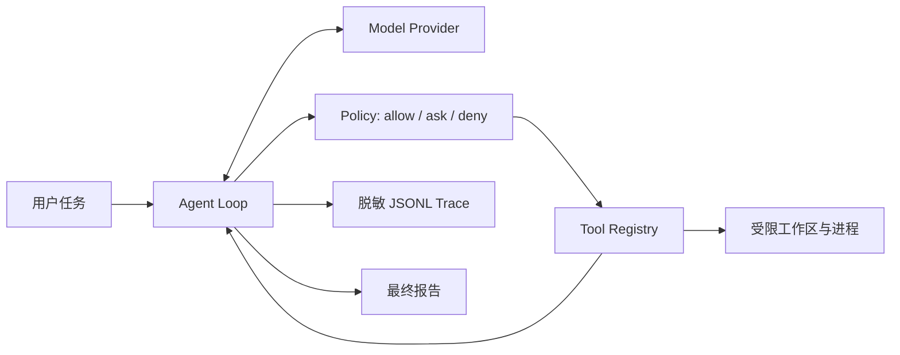

# Pi-Claw

一个面向 Agent 初学者和面试演示的轻量本地 Coding Agent：**可审计、可回放、默认只读，
并且没有 API key 也能完成离线验收。**

Pi-Claw 不追求工具数量，而是把最重要的工程边界做清楚：模型只能提出结构化工具调用，
Policy 决定允许、询问或拒绝，Tool 才能接触文件与进程；CLI 所有步骤默认写入脱敏 JSONL
轨迹，作为库嵌入时由调用方显式传入 TraceWriter。

## 先用 5 分钟跑通

项目统一使用 [uv](https://docs.astral.sh/uv/) 管理 Python、依赖和命令。不要再单独运行
`pip install`，也不需要手工创建虚拟环境。

```bash
cd /Users/huanghx/project/pi-claw
uv sync

# 默认只读：写入和测试命令会被拒绝，但能看到完整审批流
uv run pi-claw demo

# 明确批准临时演示目录中的精确替换和 unittest
uv run pi-claw demo --yes
```

演示会在临时目录创建一个有 bug 的 `calculator.py`，依次执行读取、精确替换、单元测试和
最终报告，然后清理临时目录。每次运行都会打印持久化 trace 的绝对路径。

回放只读取历史事件，不会再次修改文件或执行命令：

```bash
uv run pi-claw replay runs/pi-claw-你的时间戳.jsonl
```

## 整体架构



核心公式仍然是 `workflow + loop + tools = agent`，但真正可用的项目还需要：结构化协议、
停止条件、权限控制、错误结果、资源上限、可观测性和可重复测试。

### 模块职责

- `schemas.py`：Provider、Agent、Policy 和 Tool 之间的结构化数据。
- `providers.py`：离线 Scripted Provider 与可选 OpenAI-compatible Provider。
- `agent.py`：有最大步数的单 Agent 循环。
- `policy.py`：路径、敏感文件、写入审批和命令参数级白名单。
- `workspace.py`：真实路径解析，阻止目录穿越与符号链接逃逸。
- `tools.py`：文件枚举、搜索、读取、精确替换和受限 argv 命令。
- `trace.py`：凭据脱敏、JSONL 写入与只读回放。
- `cli.py`：命令行参数、用户审批和离线演示。

详细数据流见 [架构文档](docs/ARCHITECTURE.md)，安全边界见
[安全模型](docs/SECURITY.md)。

## 三种运行方式

### 1. 离线完整演示

```bash
uv run pi-claw demo --yes
```

这是首选验收方式。Scripted Provider 固定模型动作，用于证明 Agent loop、工具、策略、测试和
trace 能稳定工作；它不用于宣称真实模型效果。

### 2. 在指定仓库做离线只读冒烟检查

```bash
uv run pi-claw run \
  "列出工作区文件" \
  --workspace /你的/仓库/绝对路径 \
  --provider scripted
```

该模式只执行一次受限文件枚举，不会假装完成代码修改。

### 3. 可选真实模型

真实模式需要外部 API key，离线演示和测试不需要。获取、配置、验证和故障排查见
[API Key 配置计划](docs/API_KEY_GUIDE.md)。本项目当前适配的是 OpenAI-compatible
`/chat/completions` 与单工具调用格式；供应商、模型和端点必须确实支持这一协议。

```bash
export OPENAI_API_KEY="你的密钥，不要提交到 Git"
export OPENAI_MODEL="支持 Chat Completions 工具调用的模型 ID"
# 仅第三方兼容服务需要设置；OpenAI 官方可省略
export OPENAI_BASE_URL="https://你的服务/v1"

uv run pi-claw run \
  "只读检查这个仓库并给出建议" \
  --workspace /你的/仓库/绝对路径 \
  --provider openai
```

只有在你理解目标变更并愿意逐次批准时才添加 `--yes`。首版 CLI 的 `--yes` 是批量批准
策略允许的写入和命令，适合受控演示，不适合不可信仓库。

## 安全设计摘要

- 默认只读；写入和命令即使在白名单内也需要批准。
- 所有路径必须位于工作区，拒绝 `..`、外部绝对路径、敏感文件和符号链接越界。
- 命令必须是 argv 数组，绝不使用 `shell=True`；参数本身也经过限制。
- 子进程只继承最小环境变量白名单，不会得到 API key、token 或 password。
- 文件数、扫描字节、读取量、写入量、命令输出、命令时间和 Agent 步数都有上限。
- Trace 递归脱敏，Replay 没有 ToolExecutor，不能重新执行副作用。

这不是生产级 OS Sandbox。获批的 Python 测试仍会执行仓库代码；不可信代码应放入由用户自行
准备的容器或虚拟机，应用层 Policy 也不能因此删除。

## 测试与质量检查

```bash
uv sync
uv run pytest
uv run ruff check src tests
```

测试分为协议/循环、工具集成和安全边界。最终结果应以当前命令输出为准，不在文档中伪造固定
数量或成功率。

## 学习顺序

如果详细代码看不过来，按下面顺序学习：

1. 先读这份 README 和 [项目边界](docs/PROJECT_SCOPE.md)，画出数据流。
2. 运行默认只读 demo，观察一次审批拒绝。
3. 加 `--yes` 再运行，比较两份 trace。
4. 只读 `schemas.py`、`agent.py`、`policy.py` 三个入口文件。
5. 主动制造路径穿越、重复替换文本或最大步数错误，再看测试如何定位。
6. 最后接真实模型，比较离线基线与真实结果。

完整安排见 [7 天学习计划](docs/LEARNING_PLAN.md)。PDF 中的高度简化说法与更严谨定义见
[概念纠偏](docs/CONCEPT_CORRECTIONS.md)，面试演示见
[面试指南](docs/INTERVIEW_GUIDE.md)。

## Git 工作流

项目已使用 Git 管理，并按“边界与文档 → 实现 → 测试与验收”拆分提交。继续练习时建议：

```bash
git status --short
git diff
uv run pytest

# 只暂存本次明确修改的文件，不使用 git add .
git add 具体文件路径
git commit -m "type: 描述这一步的目标"
```

Pi-Claw 不会自动 commit 或 push；版本控制权始终由用户掌握。
