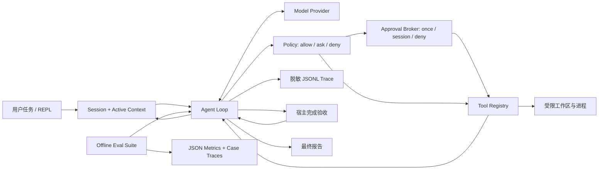

# Pi-Claw

一个使用 **Python 3.12 + uv** 实现、沿 Kimi CLI 学习路线逐步演进的轻量本地 Coding Agent：
**可恢复会话、可审计、可回放、默认只读，并且没有 API key 也能完成离线验收。**

Pi-Claw 学习 Kimi CLI 类 Coding Agent 的关键工程问题：持久会话、项目提示词、上下文压缩、
结构化工具、逐次审批和可恢复执行。它不是 Kimi Code 的完整复刻，也不声称达到其完整功能、
模型效果、平台集成或生产成熟度。

项目分两层理解：**v0 安全内核**先把 Workspace、Policy、Tool、Trace 和离线测试做稳；
**v1 会话式 Agent**再叠加 Session、Context、项目 Prompt、三态审批和 `chat` CLI。模型只能提出
结构化工具调用，Policy 决定允许、询问或拒绝，Tool 才能接触文件与进程；发生写入后，宿主还会
检查实际验证 ToolResult，避免模型仅凭自然语言把未验证修改报告为完成。

## 先用 5 分钟跑通

项目统一使用 [uv](https://docs.astral.sh/uv/) 管理 Python、依赖和命令。不要再单独运行
`pip install`，也不需要手工创建虚拟环境。

```bash
cd /Users/huanghx/project/pi-claw
uv sync --locked

# v1：完全离线地运行一个可恢复会话回合
uv run pi-claw chat \
  "只读检查这个项目的入口文件" \
  --workspace "$PWD" \
  --print

# 查看会话并恢复最近一次
uv run pi-claw sessions --workspace "$PWD"
uv run pi-claw chat --workspace "$PWD" --continue

# v0 安全内核演示：默认拒绝副作用
uv run pi-claw demo

# 明确批准临时演示目录中的精确替换和 unittest
uv run pi-claw demo --yes

# 工程评测：版本化离线场景和机器可读报告
uv run pi-claw eval --workers 4
```

`chat` 默认使用确定性的离线 Provider 验证会话和只读工具链，不冒充真实模型。`demo` 会在
临时目录创建一个有 bug 的 `calculator.py`，验证读取、精确替换、单元测试和审批边界。
每次 CLI 运行都会打印持久化 trace 的绝对路径。

回放只读取历史事件，不会再次修改文件或执行命令：

```bash
uv run pi-claw replay runs/pi-claw-你的时间戳.jsonl
```

## 整体架构



核心公式仍然是 `workflow + loop + tools = agent`，但真正可用的项目还需要：结构化协议、
停止条件、权限控制、错误结果、资源上限、可观测性和可重复测试。

### 模块职责

- `schemas.py`：Provider、Agent、Policy 和 Tool 之间的结构化数据。
- `providers.py`：离线 Provider 与可选 OpenAI-compatible Provider。
- `agent.py`：持久消息、有最大步数、支持同轮多个 Tool Call 的 Agent 循环。
- `session.py`：按工作区隔离的分段消息 journal、可重放 checkpoint、Provider 元数据和审批状态。
- `context.py`：确定性、有界的上下文压缩，不覆盖 append-only 原始历史。
- `prompts.py`：系统约束与工作区根目录项目入口发现。
- `approval.py`：允许一次、本会话允许同类、拒绝；非 TTY 默认拒绝。
- `repl.py`：多轮输入、会话恢复和 `/compact` 等命令。
- `policy.py`：路径、敏感文件、写入审批和命令参数级白名单。
- `workspace.py`：真实路径解析，阻止目录穿越与符号链接逃逸。
- `tools.py`：文件枚举、搜索、读取、单点替换、全量校验后一次写回的 `apply_patch` 和受限 argv 命令。
- `trace.py`：凭据脱敏、JSONL 写入与只读回放。
- `completion.py`：依据写入后的测试/静态检查 ToolResult 验收模型完成声明。
- `eval.py`：版本化离线任务、证据断言、聚合指标和 JSON 报告。
- `cli.py`：命令行参数、用户审批和离线演示。

详细源码路径见 [工作流程与数据流](docs/WORKFLOW_AND_DATA_FLOW.md)，整体设计见
[架构文档](docs/ARCHITECTURE.md)，消息角色、Session 锁、权限与任务隔离见
[消息流、锁与并发](docs/MESSAGE_FLOW_LOCKS_AND_CONCURRENCY.md)，安全边界见
[安全模型](docs/SECURITY.md)。

## 运行与验收入口

### 1. v1 可恢复 Coding Agent 会话

交互运行：

```bash
uv run pi-claw chat --workspace /你的/仓库/绝对路径
```

CI、脚本或一次性演示使用 `--print`，它完成首条任务后退出：

```bash
uv run pi-claw chat \
  "只读检查项目并报告入口文件" \
  --workspace /你的/仓库/绝对路径 \
  --print
```

常用恢复命令：

```bash
uv run pi-claw sessions --workspace /你的/仓库/绝对路径
uv run pi-claw chat --workspace /你的/仓库/绝对路径 --continue
uv run pi-claw chat --workspace /你的/仓库/绝对路径 --session <SESSION_ID>
```

REPL 支持 `/new`、`/sessions`、`/resume <id>`、`/compact [关注点]`、`/context`、
`/history`、`/title <标题>` 和 `/exit`。详细说明见
[v1 Kimi CLI 路线](docs/KIMI_CLI_V1.md)。

REPL 内的 `/resume` 会核对目标会话记录的 Provider、模型和 Base URL。三者与当前运行时不一致
时，Pi-Claw 不会静默切换，而会打印一条带原会话参数的重启命令。

### 2. 版本化离线评测

```bash
uv run pi-claw eval --workers 4
```

默认评测覆盖最小修复与验证、测试失败后恢复、未审批写入、路径逃逸、最大步数熔断、两个并发
任务隔离场景和未验证完成拒绝。它使用真实 Agent/Policy/Tool/Trace 链路，但 Provider 动作是确定性的，因此证明
的是工程闭环，不是真实模型任务成功率。`--workers` 是独立工作区上的本机并发，不是多机分布式
Agent。指标定义和自定义 case 方法见 [评测设计](docs/EVALUATION.md)。

### 3. v0 离线安全内核演示

```bash
uv run pi-claw demo --yes
```

这是首选验收方式。Scripted Provider 固定模型动作，用于证明 Agent loop、工具、策略、测试和
trace 能稳定工作；它不用于宣称真实模型效果。

### 4. 兼容的单轮 `run` 入口

```bash
uv run pi-claw run \
  "列出工作区文件" \
  --workspace /你的/仓库/绝对路径 \
  --provider scripted
```

`run` 保留给 v0 调用方式和兼容单轮入口。它只执行一次受限文件枚举，不含完整 Session、项目
Prompt 和交互审批；新用法优先选择 `chat`。

### 5. 可选真实模型

真实模式需要外部 API key，离线演示和测试不需要。获取、配置、验证和故障排查见
[API Key 配置计划](docs/API_KEY_GUIDE.md)。指南包含 OpenAI、Kimi、Qwen/阿里云百炼和
DeepSeek。本项目当前适配 OpenAI-compatible `/chat/completions`，并能解析同轮多个标准
`tool_calls`；供应商、模型和端点必须确实支持这一协议。会话元数据中的 Base URL 必须是
不含用户名、密码、query 或 fragment 的 HTTP(S) API 根地址；模型成功响应和 HTTP 错误响应
也都有读取字节上限。

```bash
export OPENAI_API_KEY="你的密钥，不要提交到 Git"
export OPENAI_MODEL="支持 Chat Completions 工具调用的模型 ID"
# 仅第三方兼容服务需要设置；OpenAI 官方可省略
export OPENAI_BASE_URL="https://你的服务/v1"

uv run pi-claw chat \
  "只读检查这个仓库并给出建议" \
  --print \
  --workspace /你的/仓库/绝对路径 \
  --provider openai
```

只有在你理解目标变更并愿意逐次批准时才添加 `--yes`。当前 CLI 的 `--yes` 是批量批准
策略允许的写入和命令，适合受控演示，不适合不可信仓库。

## 安全设计摘要

- 默认只读；写入和命令即使在白名单内也需要批准。
- 交互审批支持允许一次、本会话允许同类、拒绝；非 TTY 不会等待输入并默认拒绝。
- 所有路径必须位于工作区，拒绝 `..`、外部绝对路径、敏感文件和符号链接越界。
- 命令必须是 argv 数组，绝不使用 `shell=True`；参数本身也经过限制。
- v1 Coding Profile 只放行有限 `uv` 验证形态并仍返回 ASK；`uv add`、任意 Python、修复型
  Ruff 参数和路径逃逸仍拒绝。
- `apply_patch` 只接受一个文件的 1 到 50 个精确替换；任一 `old` 不唯一则整次不写回。
- 写审批展示有长度上限且经过脱敏的 unified diff 和目标 preimage 哈希；命令审批展示完整 argv 和
  cwd。“本会话允许”绑定完整参数与已审阅文件版本，而不是泛化成路径或命令前缀；批准后执行前
  还会复核目标文件哈希。
- 会话 journal 每行有递增 `seq`，活动上下文是带 `through_seq` 的 checkpoint；大 journal 会分段。
  恢复时重放 checkpoint 后的尾记录，忽略最后一条未完整落盘的行，并为缺失结果的 Tool Call
  补失败标记，但不会自动重放工具。
- 子进程只继承最小环境变量白名单，不会得到 API key、token 或 password。
- 文件数、扫描字节、读取量、写入量、命令输出、命令时间和 Agent 步数都有上限。
- 会话目录/文件显式使用 `0700/0600`；同一 Session 的提交由文件锁串行化，旧序号写入会拒绝。
  会话 append、checkpoint、state 和工具文件写入会 `fsync`。
  已有文件使用同目录临时文件加 `os.replace`，新文件使用硬链接独占创建；这提高中断恢复能力，
  不等于数据库事务或跨所有文件系统的绝对断电保证。
- 恢复会沿用 Provider、模型和 Base URL，但不落盘 API key；REPL 不会静默混用不同运行时。
- OpenAI-compatible 响应体有字节上限，Base URL 元数据拒绝内嵌凭据、query 和 fragment。
- Trace 递归脱敏，Replay 没有 ToolExecutor，不能重新执行副作用。

这不是生产级 OS Sandbox。获批的 Python 测试仍会执行仓库代码；不可信代码应放入由用户自行
准备的容器或虚拟机，应用层 Policy 也不能因此删除。

## 测试与质量检查

```bash
uv sync --locked
uv lock --check
uv run pytest
uv run ruff check src tests
uv run pi-claw eval
```

测试分为协议/循环、工具集成和安全边界。最终结果应以当前命令输出为准，不在文档中伪造固定
数量或成功率。

## 学习顺序

如果详细代码看不过来，按下面顺序学习：

1. 先读这份 README 和 [项目边界](docs/PROJECT_SCOPE.md)，画出数据流。
2. 运行默认只读 demo，观察一次审批拒绝。
3. 加 `--yes` 再运行，比较两份 trace。
4. 用 `chat --print` 创建会话，再用 `sessions` 和 `--continue` 恢复。
5. 依次读 `schemas.py`、`agent.py`、`policy.py`、`session.py` 四个入口文件。
6. 主动制造路径穿越、补丁不唯一、非 TTY 审批或最大步数错误，再看测试如何定位。
7. 最后接真实模型，比较离线基线与真实结果。

完整安排见 [7 天学习计划](docs/LEARNING_PLAN.md)。PDF 中的高度简化说法与更严谨定义见
[概念纠偏](docs/CONCEPT_CORRECTIONS.md)，每轮修改见
[迭代说明书](docs/iterations/README.md)。

与 Kimi CLI、pi-mono、Aider、OpenCode 和 OpenHands 的中性工程对照见
[开源 Coding Agent 对照](docs/UPSTREAM_CODING_AGENT_COMPARISON.md)。

## Git 工作流

项目已使用 Git 管理，并按“边界与文档 → 实现 → 测试与验收”拆分提交。继续练习时建议：

```bash
git status --short
git diff
uv run pytest

# 只暂存本次明确修改的文件，不使用 git add .
git add 具体文件路径
git commit -m "type: 描述这一步的目标"
```

Pi-Claw 不会自动 commit 或 push；版本控制权始终由用户掌握。
