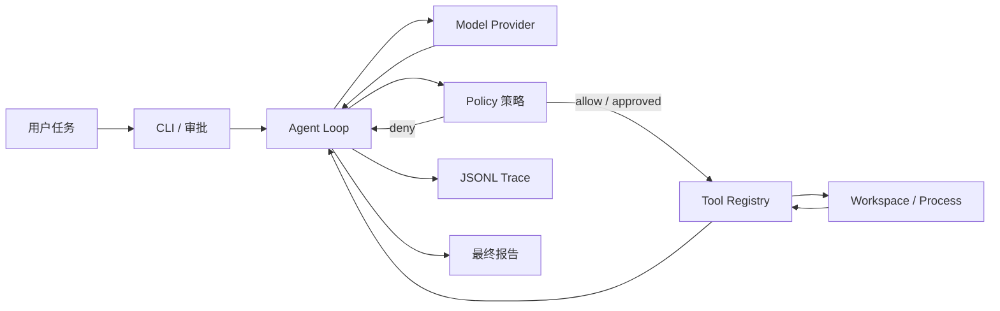

# 架构与数据流

## 先看整体，而不是先看代码

Pi-Claw 把 Coding Agent 拆成五层。每层只做一件事，依赖方向从上到下，避免模型直接接触
文件系统或进程。

最重要的边界是：模型只能提出 `ToolCall`，不能直接读写文件或执行命令。每个调用必须先经过
Policy，再由 Tool Registry 执行，结果以 `ToolResult` 返回。这样可以单独测试模型、策略和工具。

## 一次运行的数据流

1. CLI 读取任务、工作区、最大步数和批准方式。
2. Agent 把系统约束和用户任务交给 Model Provider。
3. Provider 返回最终文本，或返回一个或多个结构化 ToolCall。
4. Policy 检查工具名、路径、敏感文件、命令白名单和是否需要人工批准。
5. Tool 执行后返回结构化结果；异常会转换成失败结果，不泄漏为未处理堆栈。
6. Agent 将结果追加到上下文和 JSONL trace，再进入下一轮。
7. 得到最终文本或达到最大步数后停止，绝不无限循环。

## 为什么保留两种 Model Provider

- `ScriptedProvider`：固定返回预先写好的步骤。它不是“假装智能”，而是隔离变量，让工具、安全、
  trace 和 Agent loop 在无网络、无 API key 时仍可重复验收。
- OpenAI-compatible Provider：用于真实模型实验。它只负责协议转换，不改变 Agent、Policy 或 Tool。

先让离线基线稳定，再比较真实模型的成功率、步骤数、延迟和失败类型，才能判断 prompt 或模型
更换是否真的带来提升。

## Trace 与 Replay

每次关键事件按顺序写入 JSONL。Trace 是审计证据，不是再次执行的脚本；Replay 只读取并展示
历史事件，不会重新运行写文件或命令。常见 token、key、password 字段在落盘前会被替换。

## 后续扩展顺序

1. 固定任务评测与失败分类。
2. 更精确的上下文压缩和带来源的本地记忆。
3. Docker Sandbox 适配器（用户自行准备 Docker）。
4. Reviewer Subagent；只有评测证明有效后，再尝试并行 Agent Team。

