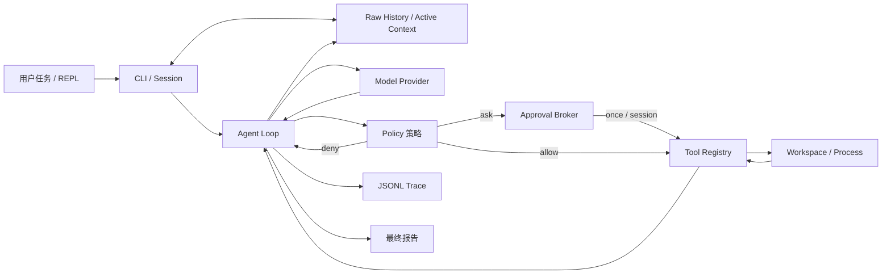

# 架构与数据流

## 先看整体，而不是先看代码

Pi-Claw 使用 Python 和 uv，沿 Kimi CLI 路线把 Coding Agent 拆成可单独验证的层。v1 在 v0
安全内核上增加会话和上下文，不会让模型绕过原有 Policy 直接接触文件系统或进程。

最重要的边界是：模型只能提出 `ToolCall`，不能直接读写文件或执行命令。每个调用必须先经过
Policy，再由 Tool Registry 执行，结果以 `ToolResult` 返回。这样可以单独测试模型、策略和工具。

## v0 到 v1 的职责边界

- **v0 安全内核**：Schemas、Workspace、Policy、Tool、Trace、Provider 与有界 Agent Loop。
- **v1 会话式 Agent**：在 v0 之上增加系统/项目 Prompt、SessionStore、Active Context、
  ContextManager、TerminalApprovalBroker、REPL 和 `chat/sessions` CLI。

v1 是 Kimi CLI 路线的学习实现，不是 Kimi Code 的完整复刻，也不声称具有相同模型效果、
全部命令、IDE 集成、远程服务或生产可靠性。

## 一个会话回合的数据流

1. `chat` 按真实工作区加载或创建 Session，并读取活动上下文；不存在活动窗口时退回原始历史。
2. 新会话生成系统提示词，并只读取根目录约定入口文件作为带来源的项目数据。
3. Agent 把持久消息和新用户任务交给 Model Provider。
4. Provider 返回最终文本，或返回一个/多个结构化 ToolCall。
5. 同轮 ToolCall 先写成一条 assistant 消息，再按顺序经过 Policy、审批和 Tool 执行；首版不并行。
6. 每个 ToolResult 单独追加到上下文、append-only 原始历史和 JSONL trace。
7. 活动窗口过大时做确定性压缩，原始 `context.jsonl` 不覆盖，压缩结果保存为活动上下文。
8. 得到最终文本或达到最大步数后停止；会话 ID 可用于后续恢复。

同轮多个 ToolCall 应彼此独立。有先后依赖的动作必须等待上一轮 ToolResult，不能把顺序执行
误写成事务或并行执行保证。

## 为什么保留两种 Model Provider

- `ScriptedProvider` / `OfflineCodingProvider`：确定性离线路径。它们不是“假装智能”，而是隔离
  变量，让工具、安全、会话、trace 和 Agent loop 在无网络、无 API key 时仍可重复验收。
- OpenAI-compatible Provider：用于真实模型实验。它只负责协议转换，不改变 Agent、Policy 或 Tool。

真实 Provider 由同一个 OpenAI-compatible `/chat/completions` 适配器连接 OpenAI、Kimi、
Qwen/百炼、DeepSeek 或其他兼容服务。先让离线基线稳定，再比较真实模型的成功率、步骤数、
延迟和失败类型。

## Session、Raw History 与 Active Context

- `context.jsonl` 是 append-only 原始消息历史，用于审计和恢复，不因压缩而覆盖。
- `active_context.json` 是下一轮实际加载的有界活动窗口，可以包含确定性摘要。
- `state.json` 保存标题、时间、Provider/模型/Base URL 和本会话已批准的工具 scope，不保存 key。
- 会话按工作区真实路径哈希隔离，拒绝用其他工作区加载同一 Session ID。
- 默认数据目录为 `~/.pi-claw/sessions`，可用 `PI_CLAW_HOME` 或 CLI `--data-dir` 覆盖。

Context 压缩保留第一条系统消息和最近消息，把历史工具输出明确标成不可信数据。事件数和读取
字节都有上限，防止损坏或恶意会话文件造成无界加载。极端结构若无法在不破坏 system 或
tool-call/result 原子组的前提下缩小，会明确失败，不会构造发给 Provider 的非法上下文。

## Tool 与审批

读取工具由 Policy 直接允许。写入和命令即使语法安全仍返回 ASK，由终端审批器选择允许一次、
本会话允许同类或拒绝；非 TTY 默认拒绝，不会在 CI 中等待输入。硬拒绝不能被 `--yes` 绕过。

`write_or_replace` 用于单处精确替换；`apply_patch` 对同一文件执行 1 到 50 个顺序精确替换，
先在内存验证全部 edit，通过后一次写回；任一 `old` 不唯一则零写入。它不是抗崩溃的 OS 级
原子替换。Agent 单轮最多接受 16 个 Tool Call，超过上限会在执行前安全失败。

## Trace 与 Replay

CLI 每次运行都把关键事件按顺序写入 JSONL；嵌入库时由调用方显式传入 TraceWriter。Trace 是
审计证据，不是再次执行的脚本；Replay 只读取并展示历史事件，不会重新运行写文件或命令。
常见 token、API key、password 字段在落盘前会被替换，单事件与 replay 总量都有上限。

## 后续扩展顺序

1. 固定任务评测与失败分类。
2. 使用固定评测验证上下文压缩质量，而不是只比较消息数量。
3. Docker Sandbox 适配器（用户自行准备 Docker）。
4. Reviewer Subagent；只有评测证明有效后，再尝试并行 Agent Team。
