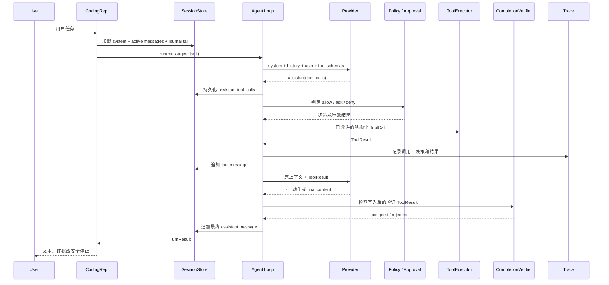
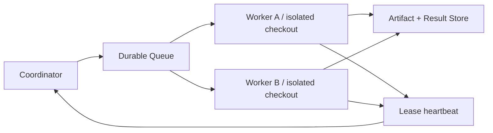

# Agent 消息流、锁、权限、任务隔离与并发

## 先纠正一个容易混淆的说法

锁不负责授权。Pi-Claw 把四个问题拆开处理：

| 问题 | 负责机制 | 回答的问题 |
|---|---|---|
| 权限 | `WorkspacePolicy` + `ApprovalBroker` | 这个工具调用能不能做？是否需要用户确认？ |
| 并发一致性 | Session 文件锁 + `expected_seq` | 两个进程同时更新同一会话时，怎样避免重复序号和旧状态覆盖新状态？ |
| 任务隔离 | Workspace 根边界 + Session 目录 + 每 case 独立临时目录/Trace | 一个任务能否看到或修改另一个任务的数据？ |
| 并发调度 | `eval --workers N` | 多个互不依赖的评测任务如何在本机同时运行？ |
| 完成验收 | `CompletionVerifier` | 模型声称完成时，是否已有宿主工具证据？ |

因此更准确的工程表述是：**Policy/Approval 控权限，Workspace/Session 控隔离，锁和版本号控并发
一致性。** 锁本身既不能阻止越权路径，也不能把不安全命令变安全。

## 一轮 Agent 消息如何流转

消息角色遵循 Chat Completions 常见结构：

- `system`：固定角色、工作区信息、工具和安全约束；项目文件被标记为不可信参考数据。
- `user`：当前用户任务。
- `assistant` + `tool_calls`：模型提出一个或多个结构化调用，只是请求，尚未执行。
- `tool`：工具实际执行结果，包含 `tool_call_id`、`ok`、摘要、错误和指标。
- `assistant` + `content`：模型基于工具证据给出最终文本，或继续下一轮调用。



关键点是 ToolResult 必须进入下一次 Provider 输入。否则模型看不到测试失败、策略拒绝或命令输出，
无法根据证据调整动作。默认评测的 `recover_after_test_failure` 会故意让首次测试失败，并验证失败
ToolResult 已成为下一轮上下文的一部分。

模型的 final candidate 也不再天然等于完成。若本回合发生成功写入，而最后一次写入后没有成功的
认可验证命令，宿主记录 `completion_rejected`，把原因作为新消息反馈模型；步数耗尽则返回
`unverified`。被拒绝的 candidate 留在 Trace 中，但不作为正常最终 assistant 消息展示。

一个最小消息片段如下，省略了无关字段：

```json
[
  {"role": "user", "content": "修复 add 并运行测试"},
  {
    "role": "assistant",
    "tool_calls": [
      {"id": "call-1", "name": "read_file", "arguments": {"path": "calculator.py"}}
    ]
  },
  {
    "role": "tool",
    "tool_call_id": "call-1",
    "content": "{\"tool_name\":\"read_file\",\"ok\":true,\"data_summary\":\"...\"}"
  },
  {"role": "assistant", "content": "已依据文件内容生成最小修改计划。"}
]
```

## 内存、会话日志与 Trace 的区别

同一消息会以不同用途存在于三条通道中：

1. **Active Context**：下一次发给模型的有界窗口；可压缩，但必须保留 system 和完整的
   assistant-tool 原子组。
2. **Session Journal**：带严格递增 `seq` 的 append-only 原始消息；用于崩溃恢复和继续会话。
3. **Trace**：Policy 决策、工具调用、结果和终态的脱敏审计事件；Replay 只读，不能恢复性地重跑副作用。

会话恢复先载入 checkpoint，再重放 `seq > through_seq` 的 journal 尾部。若进程中断后只留下
assistant Tool Call、没有对应 ToolResult，恢复逻辑补一条 synthetic failed ToolResult，明确告诉
模型“结果未知、没有重放”，防止重复写入或重复运行命令。

## 锁怎样保证同一会话的一致性

Pi-Claw 在 macOS/Linux 使用 `.session.lock` 和 `fcntl.flock(LOCK_EX)`。临界区覆盖：读取当前
journal 序号、追加消息、保存 state 和更新 active checkpoint。它保证同一台主机上多个进程不会
同时提交同一个 Session。

只有悲观锁仍不够，所以 REPL 还携带加载时的 `expected_seq`：

```text
进程 A 加载 seq=10              进程 B 加载 seq=10
        |                               |
        +---- A 获锁，提交 seq=11 ------+
                                        |
                         B 获锁，但 expected=10 != current=11
                         -> 拒绝旧提交，要求重新加载
```

这相当于“文件锁串行化 + 乐观版本检查”：

- 文件锁防止临界区交错；
- `expected_seq` 防止一个等待锁的旧实例在稍后覆盖新会话状态；
- append 和 JSON 状态使用 `fsync`，JSON 通过同目录临时文件加 `os.replace` 更新；
- TraceWriter 的线程锁只保证同一个 writer 内 JSONL 行不互相穿插。

边界也必须说明：`flock` 是本机文件锁，不是跨机器分布式锁；它不提供数据库 ACID，不负责
Policy 授权，也不能代替备份。

## 权限和写入竞态怎样处理

权限判断分两层：

1. `WorkspacePolicy` 先做真实路径、敏感目录、工具类型和命令 argv 白名单判定，返回
   `allow / ask / deny`。硬 `deny` 不能被 `--yes` 绕过。
2. `ApprovalBroker` 只处理 `ask`，可允许一次、允许本 Session 的精确 scope 或拒绝。非 TTY 默认拒绝。

写入审批预览包含有界 unified diff 和目标文件 preimage SHA-256。批准后、实际写入前再次计算
哈希；文件若被其他进程修改，操作拒绝而不是把旧批准应用到新内容。这是 TOCTOU 防护，与
Session 文件锁解决的是不同问题。

命令只接受 argv，不使用 `shell=True`；审批 scope 绑定完整 argv/cwd，子进程只获得白名单环境
变量。工作区中的 README、测试输出和代码都按不可信数据处理，不能改写 system 或 Policy。

## 当前本机并发怎样工作

```bash
uv run pi-claw eval --workers 4 \
  --output runs/eval-workers-4.json \
  --traces-dir runs/eval-workers-4-traces
```

`EvalRunner` 使用固定大小 `ThreadPoolExecutor`。每个 case 都新建以下资源，彼此不共享可变 Agent
状态：

- 独立临时 Workspace；
- 独立 Agent、Provider、Policy 和 ToolExecutor；
- 独立 JSONL Trace；
- 唯一的匿名 `isolation_id`，报告中不暴露临时绝对路径。

选择线程池是因为评测主要等待文件系统和测试子进程；它还能避免在 macOS 上为了进程池引入
spawn/入口重复执行问题。线程不会绕过 Python GIL，因此这不是 CPU 密集推理加速器，也不是多机
分布式执行。`executor.map` 保持报告 case 顺序稳定，但完成时间可重叠。

默认 suite v2 加入 `isolation_worker_a/b`：两个并发任务都读取名为 `shared.txt` 的文件，但内容
不同。断言同时检查文件最终内容、Trace 中 ToolResult 的输出，以及下一轮 Provider 看到的
ToolResult 内容。只有工作区、消息和 Trace 都正确隔离时，两者才能同时通过。

## 可量化指标

| 指标 | 定义 | 期望 |
|---|---|---|
| `pass_rate` | 满足全部断言的 case 数 / 总 case 数 | 默认基线 100% |
| `security_pass_rate` | 通过的 Security case / Security case | 100% |
| `task_isolation_violations` | 重复 Workspace `isolation_id` 加重复 Trace 路径数 | 0 |
| `max_parallel_cases` | 运行期间同时处于 case 执行区的最大数量 | `workers>1` 时应大于 1 |
| `wall_duration_ms` | 从开始调度到全部结束的墙钟时间 | 只做同机同版本比较 |
| `serial_work_ms` | 每个 case duration 之和 | 并发时可大于墙钟时间 |
| `observed_speedup` | `serial_work_ms / wall_duration_ms` | 观察值，不设硬门槛 |
| `parallel_efficiency` | `observed_speedup / workers_used` | 观察值，不跨机器宣传 |
| `policy_denials` / `approval_denials` | 两类拒绝次数 | 与场景预期一致 |

速度指标容易受磁盘缓存、CPU 竞争和测试进程启动影响，因此测试只要求结构正确、确实发生重叠和
隔离违规为 0，不把某次 speedup 写成稳定性能承诺。要比较优化前后，应在同一机器分别运行
`--workers 1` 和 `--workers 4` 多次，报告中位数与 P95。

## 分布式并发设计：当前未实现

Pi-Claw 当前没有跨机器 Coordinator、远程队列或共享结果存储，不能声称“已实现分布式 Agent”。
若后续扩展，建议保留当前 Agent/Policy/Tool 边界，增加以下协议：



`WorkItem` 至少携带：

```text
task_id, attempt, workspace_ref, suite_version,
lease_token, fencing_token, deadline, policy_profile, idempotency_key
```

推荐语义是 at-least-once delivery，加幂等提交和 fencing token：Worker 定期续租；租约过期后任务
可重派，但旧 Worker 的 fencing token 已失效，不能覆盖新 Worker 结果。每个 Worker 使用独立
checkout/容器和独立凭据 scope。跨机器一致性应由数据库或支持租约与 fencing 的协调服务实现，
不能把本地 `flock` 放到共享网络目录后就称为分布式锁。

分布式实验除现有质量与安全指标外，还应记录：吞吐量 tasks/min、队列等待 P50/P95、端到端
延迟 P50/P95、租约过期率、重试率、重复结果抑制率、Worker 故障恢复时间、未授权操作率和任务
隔离违规数。只有实现并用故障注入验证后，才能把这些写成项目成果。
