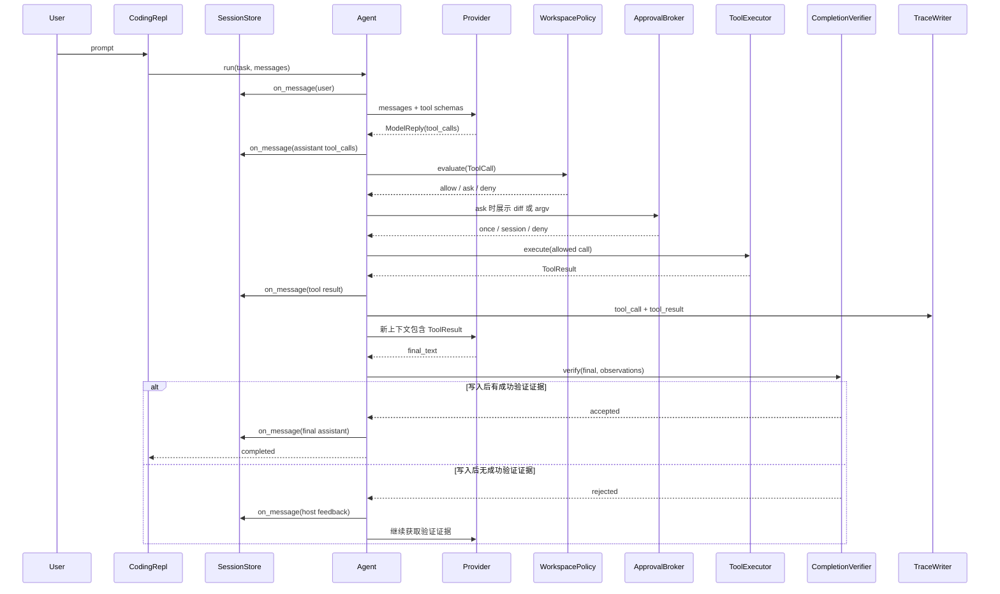

# Pi-Claw 工作流程与数据流路径

## 1. 从命令行到 Agent Runtime

```text
src/pi_claw/__main__.py
  -> cli.main()
  -> cli._run_chat()
  -> SessionStore.load/create()
  -> CodingRepl.__init__()
  -> CodingRepl._build_runtime()
  -> CodingRepl.run_turn()
  -> Agent.run()
```

`cli._run_chat()` 解析工作区、Provider、模型、Session 和 Trace。`CodingRepl` 负责交互及持久化，
但不直接执行文件或命令；它在 `_build_runtime()` 中组合 Policy、Approval、ToolExecutor、Agent、
ContextManager 和 CompletionVerifier。

## 2. 一个用户回合的消息路径



消息顺序为：

```text
system
user
assistant(tool_calls)
tool(ToolResult)
assistant(tool_calls 或 final_text)
```

工具失败不会抛出到循环外，而是形成 `ToolResult.ok=false` 进入下一轮上下文。模型只有看到真实
失败、拒绝和退出码，才有机会调整计划。

## 3. 工具执行与权限路径

```text
Agent
  -> ToolExecutor.execute(call)
  -> WorkspacePolicy.evaluate(call)
      -> Workspace.resolve(realpath)
      -> 敏感路径/argv/command profile 校验
  -> ApprovalBroker（仅处理 ask）
  -> ToolRegistry handler
      -> list_files / search_text / read_file
      -> write_or_replace / apply_patch
      -> run_command
  -> ToolResult
```

职责不能混淆：Policy 决定是否允许，Approval 决定本次是否授权，Workspace 限定真实路径边界，
Session 锁只解决并发一致性。模型不能直接访问文件系统，也不能用自然语言扩大权限。

## 4. 完成状态路径

Pi-Claw 不再把所有 `final_text` 自动视为完成。CLI、REPL 和 Eval 使用
`ToolEvidenceCompletionVerifier`：

```text
无成功写入
  -> 允许结束，但只表示不需要代码变更验收

存在成功写入
  -> 找最后一次写入之后的认可验证命令
  -> pytest / unittest / ruff check / ruff format --check / compileall / uv lock --check
  -> 至少一个真实 returncode=0 才接受 completed
  -> 否则 completion_rejected，原因反馈给模型
  -> 步数耗尽仍无证据则返回 unverified
```

这是最低限度的证据门，不等于证明所有业务需求正确。后续可以为具体任务注入更严格的验收器，
要求指定测试、diff 范围或结构化产物。

## 5. 持久化数据路径

默认会话根目录：

```text
~/.pi-claw/sessions/
  <workspace_sha256_prefix>/
    <session_id>/
      state.json
      context.jsonl
      context-<start_seq>.jsonl
      active_context.json
      .session.lock
```

- `state.json`：Session 元数据、Provider/模型/Base URL、持久审批 scope；不保存 API Key。
- `context*.jsonl`：带递增 `seq` 的 append-only 原始消息分段。
- `active_context.json`：下一轮发送给模型的有界 checkpoint。
- `.session.lock`：本机跨进程排他锁；与 `expected_seq` 一起阻止 stale writer。
- `runs/*.jsonl`：脱敏 Trace，记录模型回复、Policy/工具结果及完成验收事件。
- `runs/*.json`：离线 Eval 聚合报告。

项目代码只在显式 Workspace 内读写；会话数据和 Trace 不承担源码版本管理职责。

## 6. Context 压缩路径

```text
Agent.run()
  -> ContextManager.needs_compaction()
  -> ContextManager.compact()
      -> 保留完整 system
      -> 摘要较早消息
      -> 保留最近消息
      -> 保持 assistant tool_calls + tool results 原子组
  -> SessionStore.save_active_messages()
```

压缩只改变活动窗口，不覆盖原始 journal。恢复时先读取 checkpoint，再重放 `seq > through_seq`
的 journal 尾部；中断的 Tool Call 会补 synthetic failed ToolResult，不自动重放副作用。

## 7. Eval 数据路径

```text
eval_cases.json
  -> EvalRunner
  -> 每 case 独立 TemporaryDirectory/Workspace
  -> 独立 Agent/Provider/Policy/ToolExecutor/Trace
  -> 宿主断言状态、ToolResult、事件和文件内容
  -> EvalReport JSON
```

`--workers N` 只并发独立 case，报告顺序保持稳定。离线 Eval 验证工程执行链，不代表真实模型
规划能力；真实 Kimi/Qwen/DeepSeek/OpenAI 需要单独、重复运行并记录成功率、成本和延迟。
